## Nivel macro: instituciones

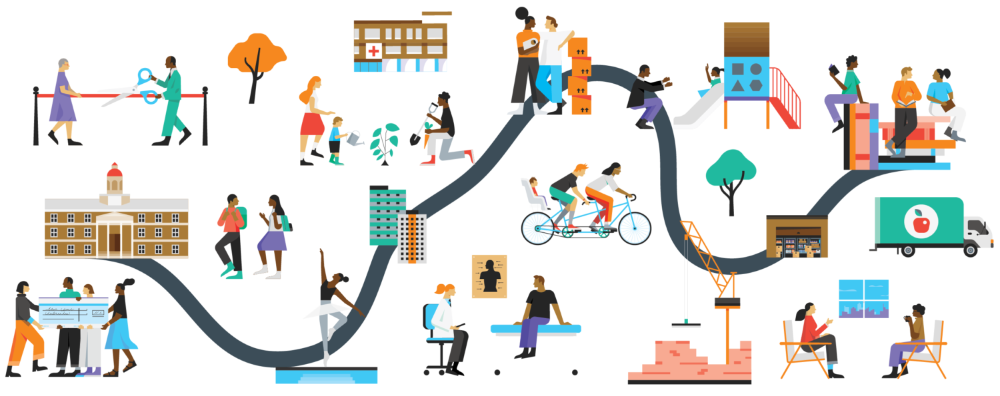{fig-align="center" width="95%"}

## Instituciones generizadas

-   Además de ser un conjunto de ideas y algo que uno "hace", el género también es un **principio organizador** que permea nuestras instituciones sociales.
-   Las creencias e ideas de género que afectan nuestros ambientes ejercen una influencia en nuestras vidas **independiente** de nuestras propias creencias, personalidades e interacciones.
-   El género permea en las **normas** (creencias y prácticas conocidas y seguidas ampliamente) y **políticas** (expectativas y reglas explícitas y codificadas) institucionales.

## *Gendered institutions*

:::: {.columns}
::: {.column width="42%"}
-   El género se usa como principio organizador, por ejemplo, **canalizando** a hombres y mujeres hacia diferentes espacios o actividades, que son **valorados de manera diferente**.
-   Qué tan saliente es el género varía a través de las diferentes partes, espacios y actividades de la institución.
:::
::: {.column width="58%"}
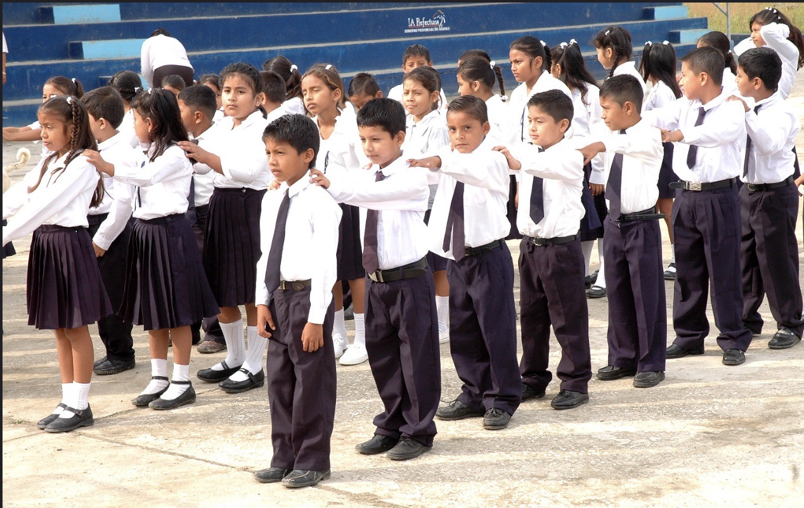
:::
::::

## Sexismo estructural

-   Las instituciones generizadas afirman y refuerzan tanto las **diferencias** como la **desigualdad** de género, de manera interseccional.
-   Resulta en **desigualdades institucionalizadas**: producidas y reproducidas por el funcionamiento rutinario de las instituciones.
-   ¿Ejemplo de Crocco-Valdivia y Galaz-Valderrama (2023) sobre universidades generizadas?

# Organizaciones generizadas

## Organizaciones generizadas

[(Acker 1990)]{.cite}

-   Antes de Acker, las organizaciones se entendían como **neutras** respecto del género.
-   El género está en la **lógica organizacional**: reglas, descripciones de cargo, escalas de salario, evaluaciones.
-   El trabajo "abstracto" supone un **trabajador universal**: hombre, dedicado por completo, sin responsabilidades de cuidado.

::: {.quote-callout}
"The concept of a universal worker excludes and marginalizes women who cannot, almost by definition, achieve the qualities of a real worker because to do so is to become a man" (Acker 1990, 150).
:::

::: {.notes}
El aporte fundacional de Acker (1990) es mostrar que el género no "entra" a las organizaciones desde afuera, a través de las personas, sino que es parte integral de su estructura y procesos, porque está implicado en los contratos en los que se basan. La naturaleza generizada de las organizaciones se esconde bajo trabajos y jerarquías aparentemente abstractos y neutros, que en realidad asumen una división del trabajo por género y están definidos por la dominancia masculina. Asumen que el trabajador típico es hombre, con cuerpo y sexualidad masculinos y un rol mínimo en la procreación. Esto marginaliza a las mujeres y sirve como estrategia de control y de mantenimiento de la segregación de género en la organización. Este "trabajador universal" reaparece en Acker 2006 como la imagen de "un hombre blanco totalmente dedicado al trabajo".
:::

## Género en cinco procesos organizacionales

[(Acker 1990)]{.cite}

1.  **Divisiones de género:** tipo de trabajo, comportamientos permitidos, uso del espacio, distribución del poder.
2.  **Símbolos e imágenes** que explican, refuerzan o se oponen a esas divisiones.
3.  **Interacciones** de dominio y sumisión.
4.  **Presentación de sí**: lenguaje, ropa.
5.  **Lógica organizacional**: reglas, contratos, evaluaciones de desempeño.

::: {.notes}
Ejemplos de cada proceso. (1) Divisiones de género: en el tipo de trabajo, los comportamientos que son permitidos, el uso del espacio físico y la distribución del poder. (2) Símbolos e imágenes: por ejemplo, la imagen del gerente como una masculinidad fuerte y exitosa. (3) Interacciones: por ejemplo, diferencias de género en las conversaciones (tomar turnos, interrupciones, tiempo de habla); aquí se conecta con lo visto en la clase 3 (Ridgeway y Correll). (4) Presentación o expresión propia: uso del lenguaje, ropa, componentes de la identidad de género que se construyen en relación con la organización. (5) Lógica organizacional: las reglas, contratos y evaluaciones de desempeño, aparentemente neutrales, que asumen al trabajador "universal".
:::

## Baños públicos {background-image="img/C4/banos.jpg" background-size="cover" .on-dark}

::: panel
**¿Qué revela el diseño y la regulación de los baños públicos sobre el género como principio organizador?**
:::

::: {.notes}
Puntos para la discusión. Separación binaria: los baños divididos en "hombres" y "mujeres" refuerzan una visión binaria del género. Supuestos corporales: se asume que los cuerpos determinan el espacio que deben ocupar. Normas de protección: la idea de que las mujeres necesitan protección en espacios públicos refuerza estereotipos de vulnerabilidad. Exclusión de identidades trans y no binarias: la estructura actual invisibiliza y excluye otras experiencias de género. Control institucional: las reglas sobre quién puede usar qué baño reflejan políticas explícitas e implícitas sobre género.
:::

## {.center}

:::: {.columns}
::: {.column width="45%"}
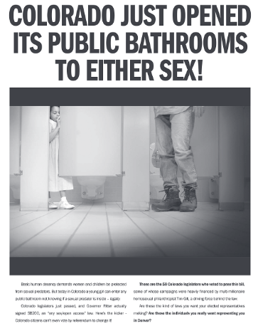{fig-align="center"}
:::
::: {.column width="55%"}
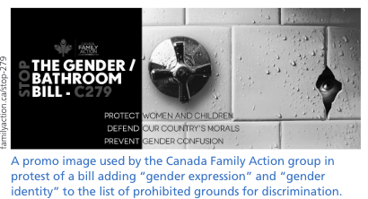{fig-align="center"}

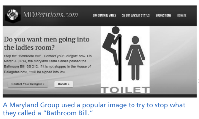{fig-align="center"}
:::
::::

## Baños y "penis panics"

[(Schilt & Westbrook 2015)]{.cite}

-   Foco solo en baños **de mujeres**, no en baños de hombres.
-   El problema son los **genitales**, no la identidad.
-   Supuesto heterosexual: los baños como zonas "libres de sexualidad".
-   Mujeres como **débiles** que necesitan protección; personas trans como merecedoras de **menos** protección.

::: {.notes}
Desarrollo de los argumentos de Schilt y Westbrook (2015). El foco en cuerpos biológicamente "masculinos" demuestra que el problema son los genitales, no la identidad. El supuesto heterosexual asume que los baños segregados son zonas libres de sexualidad. Las personas LGBTQ han sido históricamente asociadas con predadores sexuales. Se construye un espacio "solo de mujeres" en que la presencia del pene es una amenaza y un peligro. Esto reproduce la imagen de las mujeres como débiles y necesitadas de protección, e implica que las personas trans merecen menos protección que mujeres y niños. Las imágenes de la diapositiva anterior (campañas en Colorado, Maryland y Canadá) ilustran estos encuadres.
:::

## De "hacer" a "determinar" género

[(Westbrook & Schilt 2014)]{.cite}

-   **Determinar género:** prácticas mediante las cuales *otras personas e instituciones* ubican a alguien en una categoría de género.
-   Dos ideologías en tensión: **basada en la biología** (innata e inmutable) y **basada en la identidad** (si otros validan el reclamo).
-   Casos: leyes de derechos laborales trans, cambio de sexo registral, atletas trans.

::: {.notes}
Determinar género es la contracara de hacer género (clase 3): yo presento información sobre mi género, otros la interpretan y deciden en qué categoría ubicarme. Westbrook y Schilt extienden la atribución de género de West y Zimmerman, pensada para interacciones cara a cara, hacia políticas, tribunales e interacciones imaginadas (cómo las personas cis imaginan encuentros con personas trans). Por eso encaja en el nivel institucional.

El caso que abre el artículo (Littleton v. Prange, Texas, 1999): una mujer trans con documentos, matrimonio y veinte años viviendo como mujer fue declarada "cromosómicamente varón" por un tribunal; el juez escribió que "hay cosas que no se pueden hacer existir por voluntad". La ideología basada en la identidad no es un "todo vale": requiere que otros validen el reclamo como legítimo. Los tres casos analizados son proyectos de ley de no discriminación por identidad de género (2009–2011), la propuesta de Nueva York de eliminar el requisito de cirugía genital para cambiar el sexo en el certificado de nacimiento (2006) y las controversias sobre atletas trans.
:::

## Los criterios varían según el espacio {.compact}

[(Westbrook & Schilt 2014)]{.cite}

::: {style="font-size: 0.75em;"}
| Tipo de espacio | Criterio dominante | Ejemplos |
|:----------------|:-------------------|:---------|
| **No sexual, integrado** | Identidad | Lugares de trabajo |
| **No sexual, segregado** | Identidad + cuerpo | Baños, camarines, deporte |
| **Sexual** | Biología (genitales) | Relaciones sexuales |
:::

-   **Pánicos de género** y **trabajo de naturalización** restituyen el binario.
-   Los espacios de mujeres se vigilan más: desigualdad **bajo la apariencia de protección**.

::: {.notes}
Mientras más "oposición" entre géneros presupone un espacio, más se exige demostrar diferencia corporal. Pánicos de género: reacciones que reafirman frenéticamente la naturalidad del binario cuando este se ve desafiado. Trabajo de naturalización: políticas (por ejemplo, requisitos quirúrgicos u hormonales) que calman el pánico y restituyen el binario.

Una misma persona trans puede tener un "género social", un "género sexual" y un "género deportivo" distintos. Ejemplo del texto: Kye Allums, hombre trans que jugaba básquetbol universitario en un equipo de mujeres; su género social era "hombre" y su género deportivo "mujer", mientras no iniciara testosterona. El paso de criterios cromosómicos (inmutables) a genitales u hormonales (modificables) muestra cierta apertura, pero preserva la lógica del sistema sexo/género/sexualidad: las personas que podrían cuestionarlo son "repatriadas" al binario.

Vigilancia asimétrica: por creencias de que las mujeres son inherentemente vulnerables y los hombres peligrosos, el acceso a los espacios de mujeres concentra el conflicto, y se reproduce la desigualdad bajo la apariencia de proteger a las mujeres. Conectar con debates en Chile (Ley de Identidad de Género 21.120, participación de deportistas trans).
:::

# Regímenes de desigualdad

## De organizaciones generizadas a regímenes de desigualdad

[(Acker 2006)]{.cite}

::: {.quote-callout}
**Regímenes de desigualdad:** "loosely interrelated practices, processes, actions, and meanings that result in and maintain class, gender, and racial inequalities within particular organizations" (p. 443).
:::

-   Dos preguntas: ¿cómo estudiar la **interseccionalidad**? ¿Por qué **fracasan** los esfuerzos por la igualdad en las organizaciones?
-   Los regímenes están **vinculados con la sociedad**: su política, historia y cultura.
-   La organización es el lugar donde la estructura macro **se vuelve práctica concreta**.

::: {.notes}
Acker (2006) amplía su teoría de 1990 en dos direcciones: de género a clase, género y raza simultáneamente, y de describir cómo las organizaciones son generizadas a explicar por qué los esfuerzos por la igualdad suelen fracasar. Su respuesta a ambas preguntas es el concepto de regímenes de desigualdad.

La desigualdad organizacional se entiende en sentido amplio: "systematic disparities between participants in power and control over goals, resources, and outcomes" (p. 443), además de diferencias en promoción, seguridad laboral, salario, respeto y placer en el trabajo.

Vínculo con el nivel macro: "These regimes are linked to inequality in the surrounding society, its politics, history, and culture" (p. 443). Acker se diferencia explícitamente de McCall, que estudia la interseccionalidad con grandes bases de datos regionales; ella propone mirar "specific organizations and the local, ongoing practical activities of organizing work" (p. 442). Es una propuesta metodológica: la interseccionalidad se estudia en las prácticas concretas de organizar el trabajo.
:::

## Componentes de un régimen de desigualdad {.compact}

[(Acker 2006, pp. 444–455)]{.cite}

**1. Bases**

Clase, género y raza. "'Class equality' is an oxymoron" (p. 444).

**2. Forma y grado**

Jerarquía, segregación, brechas. La segregación se **reconfigura**.

**3. Procesos**

Prácticas cotidianas que producen desigualdad.

**4. Visibilidad**

Quienes dominan ven la desigualdad "en otro lado".

**5. Legitimidad**

Cuán justificada parece la desigualdad.

**6. Control**

Directo, indirecto e internalizado.

::: {.notes}
Bases de la desigualdad: clase, género y raza están casi siempre presentes. La clase tiene un estatus especial porque es intrínseca al empleo: las organizaciones se basan en relaciones de clase, por eso "'class equality' is an oxymoron" (p. 444). Acker también considera la sexualidad, la religión, la edad y la discapacidad, pero sostiene que están menos incrustadas en los procesos organizativos.

Forma y grado: pendiente de la jerarquía, segregación, brechas salariales y poder. Sobre la segregación: "What appears to be a reduction in segregation may only be its reconfiguration" (p. 446). Ejemplo de los bancos suecos: una misma categoría formal ocultaba tareas diferenciadas, "This was one job with two realities based on gender" (p. 447). Las estructuras "planas" tampoco eliminan la desigualdad: ofrecen oportunidades a las mujeres "but only if the women function like men" (p. 445).

Los componentes 3 a 6 se desarrollan en las dos diapositivas siguientes.
:::

## Procesos que producen desigualdad {.compact}

[(Acker 2006)]{.cite}

-   **Requisitos del trabajo:** organizado según "the image of a white man who is totally dedicated to the work" (p. 448).
-   **Jerarquías de clase:** sistemas de clasificación de cargos que hacen la jerarquía intocable.
-   **Reclutamiento y contratación:** "'Competence' involves judgment" (p. 450).
-   **Fijación salarial:** los salarios individualizados producen desigualdad.
-   **Interacciones informales:** exclusión de reuniones y salidas después del trabajo.

::: {.notes}
Es la sección más útil del texto para la clase, porque muestra el mecanismo concreto.

Requisitos generales del trabajo: la jornada, la disponibilidad y las obligaciones laborales se diseñan para alguien sin responsabilidades de cuidado. Conclusión de Acker: "gender, race, and class inequalities are simultaneously created in the fundamental construction of the working day and of work obligations" (p. 448). Es la continuación directa del "trabajador universal" de 1990, ahora con raza y clase.

Jerarquías de clase: los sistemas de clasificación de cargos, como el de Hay Associates, describían los trabajos femeninos con menos especificidad y no permitían comparar jefes con secretarias: "The hierarchy was inviolate in this system" (p. 449).

Reclutamiento y contratación: los criterios formales no garantizan neutralidad, porque evaluar la competencia requiere juicio, y ahí entran las creencias de estatus (clase 3).

Fijación salarial: en los bancos suecos, los incrementos discrecionales asignados por gerentes ampliaron la brecha. De ahí Acker concluye "that individualized wage-setting produces inequality" (p. 450). Correll et al. (2020), en la diapositiva siguiente, muestran el mismo mecanismo en evaluaciones de desempeño.

Interacciones informales: exclusión de reuniones o de las salidas después del trabajo (p. 451), donde circulan información y redes.
:::

## Visibilidad, legitimidad y control

[(Acker 2006)]{.cite}

-   **Visibilidad:** "People in dominant groups generally see inequality as existing somewhere else, not where they are" (p. 452).
-   **Legitimidad:** "Gender and race processes are more legitimate when embedded in legitimate class processes" (p. 453).
-   **Control:** también internalizado, como la creencia de que no tiene sentido desafiar el orden de las cosas.

::: {.box .box-q}
"High visibility and low legitimacy of inequalities may enhance the possibilities for change" (p. 454).
:::

::: {.notes}
Visibilidad: según Acker, el género tiende a "desaparecer", la clase se oculta tras el lenguaje de gestión y la raza es visible pero negada.

Legitimidad: es el argumento interseccional más fino del texto. La desigualdad de género y raza se legitima cuando se monta sobre la desigualdad de clase, que se percibe como natural en una organización (por ejemplo, cuando la segregación de género o raza aparece como "diferencias de cargo" o de "calificación"). Así, la interseccionalidad no es solo una suma de desventajas: un eje de desigualdad le presta legitimidad a otro.

Control y cumplimiento: Acker distingue controles directos (supervisión, sanciones), indirectos (tecnología, sistemas de remuneración) e internalizados. Entre estos últimos: "a belief that there is no point in challenging the fundamental gender, race, and class nature of things is a form of control" (p. 454).

La cita del recuadro conecta con la pregunta de por qué fracasan los esfuerzos por la igualdad: el cambio es más probable cuando la desigualdad es visible y pierde legitimidad.
:::

## ¿Pueden cambiar los regímenes?

[(Acker 2006, pp. 455–460)]{.cite}

-   El cambio exitoso combina **movimientos sociales y legislación** con **aliados internos**, y a menudo coerción.
-   Contradicción: reducir la desigualdad se opone a algunos **objetivos de las organizaciones**.
-   Las políticas de conciliación "may reinforce, not undermine, the male model of organizing" (p. 457).

::: {.notes}
La resistencia al cambio no es solo económica: hay hombres que defienden diferencias salariales aunque eliminarlas no los perjudique, porque su identidad masculina depende de pequeñas ventajas relativas (p. 455).

Los cambios exitosos combinan "social movement and legislative support outside the organization with active support from insiders" (p. 455), y a menudo "coercion or threat of loss" (p. 455). Hay una contradicción estructural: "The goals of inequality reduction or elimination are the opposite of some of the goals of employing organizations" (p. 456).

Políticas de conciliación: refuerzan el modelo masculino porque las usan sobre todo las mujeres, que quedan definidas como trabajadoras periféricas. Los programas de diversidad carecen de metas y plazos, y por eso no alteran la legitimidad de los sistemas de recompensa (p. 457).

Globalización: con la reestructuración, la desigualdad se vuelve "more legitimate" (p. 459), y "fear of loss of livelihood controls those who might challenge inequality" (p. 459). Conclusión: en casi todas las organizaciones la desigualdad de clase "is the normal and natural bedrock of organizing, and white men are the normal and natural top leaders" (p. 459).

Limitación para el contexto chileno: la nota 3 aclara que el análisis se basa "primarily on organizations in the United States" (p. 460), con apoyo en casos nórdicos. Crocco-Valdivia y Galaz-Valderrama (2023) permiten pensar el caso de la academia chilena.
:::

## Lógica de género en evaluaciones {.compact}

[(Correll et al. 2020)]{.cite}

-   Gran empresa tecnológica de Silicon Valley.
-   Evaluaciones de desempeño de **208 trabajadores**, hechas por sus gerentes: texto completo y puntaje (1 a 5), con 88 códigos de lenguaje.
-   Dos tipos de lenguaje:
    -   **Colaborativo:** comunal, personalidad positiva, perspectiva de equipo, trabajo de servicio.
    -   **"Hacerse cargo":** agencia, visión, líder, genio, visionario, comunicación asertiva.

## {.center}

[(Correll et al. 2020)]{.cite}

:::: {.columns}
::: {.column width="50%"}
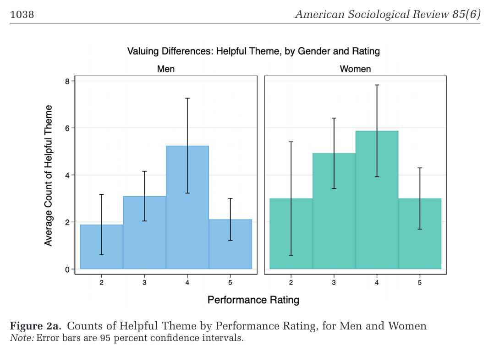
:::
::: {.column width="50%"}
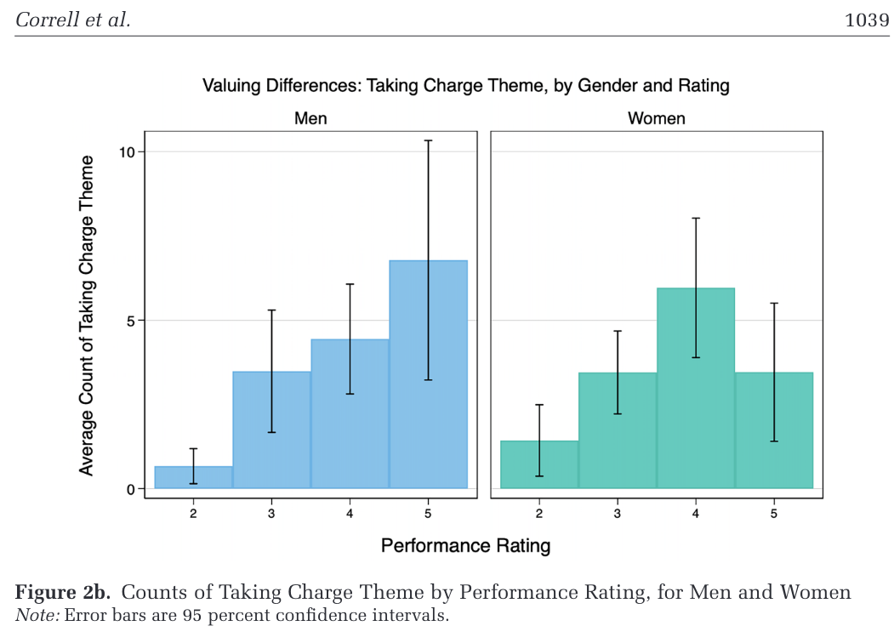
:::
::::

::: {.notes}
Figura 2a ("helpful"): el patrón es similar y no lineal para hombres y mujeres. Más lenguaje de "ayuda" se asocia con mejores puntajes entre 2 y 4, con un máximo en 4; ser "colaborador" no es común entre quienes reciben un 5. Las mujeres son vistas como más colaboradoras, pero como eso no se asocia con los puntajes más altos, ser vista como colaboradora solo lleva a las mujeres hasta cierto punto.

Figura 2b ("taking charge"): diferencias de género claras. Para los hombres la relación entre hacerse cargo y el puntaje es positiva y lineal; para las mujeres llega a su máximo en 4. Las mujeres con puntaje 5 tenían niveles de lenguaje de "hacerse cargo" similares a las de puntaje 3. Hacerse cargo se valora más en los hombres: el nivel más alto se asocia con un 5 para ellos, pero solo con un 4 para ellas. Una explicación es que hacerse cargo es una conducta muy agéntica que genera *backlash* cuando la ejercen mujeres (Rudman et al. 2012, clase 3). Es un buen ejemplo de la "lógica organizacional" de Acker: la evaluación de desempeño, aparentemente neutral, incorpora creencias de género.
:::

## La universidad como organización generizada

[(Crocco-Valdivia & Galaz-Valderrama 2023)]{.cite}

-   Revisión sistemática de **32 estudios** empíricos (2015–2020) sobre el trabajo de las académicas.
-   Las académicas están sobrerrepresentadas en **gestión y docencia**, menos valoradas que la **investigación**.
-   El **trabajo de cuidados** se replica en la universidad, con estudiantes y con colegas.
-   El **capitalismo académico** (productividad individual, competencia) profundiza esa desigualdad.

::: {.notes}
Las autoras parten del capitalismo académico (Slaughter y Rhoades): la universidad gerencialista mide desempeños individuales y premia la productividad científica. Pero sostienen que mirar la universidad solo desde la neoliberalización es universalista, y proponen verla como organización generizada (Acker 1990). Revisaron Redalyc, Latindex, Scielo, Scopus y WoS (2015–2020): de 74 artículos empíricos quedaron 32, la mayoría cualitativos, de Europa, Norteamérica y Latinoamérica.

Clasifican los estudios en cuatro grupos: (1) enfoque de igualdad (techo de cristal, brechas salariales, menos mujeres en cargos altos y en el rango de profesora titular; también los "acantilados de cristal": se nombra a mujeres en cargos de gestión cuando estos pierden prestigio o en contextos de crisis); (2) subjetividad e identidad (autocastigo, falta de tiempo, sentirse "excepcionales"; Martínez-Labrín 2015 con académicas chilenas); (3) trabajo de cuidados y afectivo (la docencia y el acompañamiento de estudiantes como tareas "maternales" o de "limpieza", que se asignan sobre todo a académicas y frenan su carrera); (4) capitalismo académico, en tránsito hacia una mirada de género.

Estudios chilenos destacados: Ríos et al. (2017), sobre la responsabilización individual y la competencia en la trayectoria académica; y Mandiola et al. (2019), con la metáfora de la "cassata": investigación masculinizada, docencia feminizada, extensión ambigua y la gestión como tarea articuladora. Conclusión central: el trabajo de cuidados de las académicas, tradicionalmente privado, se replica en la universidad, sobre todo por su inserción predominante en la gestión.

Preguntas para discutir:

1. Usando a Acker (2006), ¿qué procesos del régimen de desigualdad explican que la gestión y la docencia valgan menos que la investigación en la carrera académica? ¿Por qué esa desigualdad parece legítima, y para quién es visible?
2. Desde su propia experiencia en la universidad, ¿quién hace el trabajo de cuidado académico (acompañar estudiantes, comités, mentorías, coordinación)? ¿Debería contarse en las evaluaciones académicas, o reconocerlo arriesga reforzar la división que Acker critica en las políticas de conciliación?
:::

## Perspectiva de género en las políticas organizacionales

:::: {.columns}
::: {.column width="28%"}
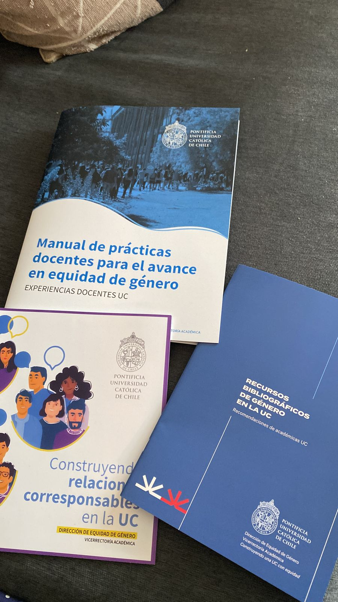{fig-align="center" height="440"}
:::
::: {.column width="72%"}
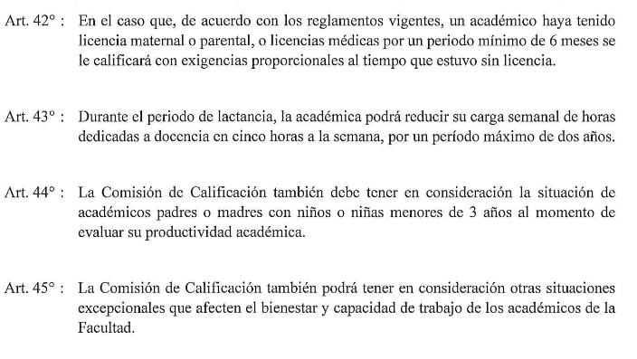{fig-align="center" width="95%"}
:::
::::

**¿Estas políticas desafían o refuerzan el modelo masculino de organización?** [(Acker 2006)]{.cite}

::: {.notes}
Ejemplo local de políticas de conciliación y equidad en la UC: manuales y guías de la Dirección de Equidad de Género, y artículos del reglamento de calificación académica que ajustan las exigencias por licencias maternales o parentales, lactancia e hijos pequeños. Desde Acker (2006), la pregunta es si estas medidas cambian el modelo del "trabajador universal" o lo dejan intacto: si las usan sobre todo las académicas, pueden marcarlas como trabajadoras periféricas sin alterar los criterios de productividad. Notar que el Art. 43 (reducción de docencia por lactancia) está formulado solo para "la académica", mientras que el Art. 44 incluye a padres y madres. Conectar con Crocco-Valdivia y Galaz-Valderrama (2023) sobre la academia chilena como organización generizada.
:::

# El contexto nacional: políticas de familia

## Antecedente: el contexto nacional importa {.center}

[(Hook 2006)]{.cite}

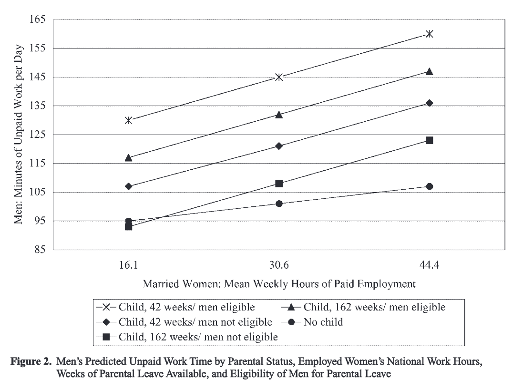{fig-align="center" height="560"}

::: {.notes}
Hook (2006) propone un modelo que integra mecanismos individuales, del hogar y nacionales para entender el trabajo no remunerado (cuidados y hogar) de los hombres. Más allá de las características individuales, pregunta qué políticas y prácticas obstaculizan o facilitan ese trabajo, y se enfoca en dos dimensiones del contexto nacional: el empleo femenino y la política del Estado.

Lectura de la figura: los padres hacen más trabajo no remunerado cuando las mujeres casadas con empleo trabajan jornada completa y cuando el permiso parental es corto y está disponible para los hombres. En contextos donde las mujeres casadas con empleo trabajan pocas horas y los hombres no pueden usar el permiso parental, se predice que los padres hacen la misma cantidad de trabajo no remunerado que los hombres sin hijos. Las prácticas nacionales de empleo femenino y las políticas nacionales son determinantes clave del tiempo de trabajo no remunerado de los padres a nivel individual. Hook y Paek (2020) dan un paso más: los efectos de las políticas dependen de la desigualdad económica del país.
:::

## Políticas de familia y empleo de las madres

[(Hook & Paek 2020)]{.cite}

-   Dos políticas: **cuidado y educación temprana** (facilita el empleo) y **licencias parentales** (lo reduce si son largas).
-   ¿Afectan igual a todas las madres y en todos los países?
-   Factor clave: la **desigualdad salarial** del país.
-   23 países, 1999–2016, **1,2 millones de madres** de niños pequeños.

::: {.notes}
Pregunta: hay acuerdo en que las políticas de familia influyen en el empleo de las madres, pero no en si sus efectos varían entre países y, dentro de cada país, según el nivel educativo de las madres (usado como aproximación a la clase social). Las autoras proponen que la desigualdad salarial (medida como la razón P90/P10 de los ingresos de las mujeres) es el factor contextual que explica ambas variaciones.

Tres mecanismos por los que la desigualdad importa: (1) costos de oportunidad: la desigualdad amplía la diferencia de ingresos entre mujeres con y sin educación universitaria; (2) narrativa de la necesidad: la necesidad económica empuja a trabajar a las mujeres, sobre todo a las que tienen parejas con bajos ingresos; (3) cuidado de mercado: la desigualdad abarata el cuidado pagado, lo que permite a las mujeres con más educación comprarlo.

Datos y método: vinculan la Encuesta de Fuerza de Trabajo de la Unión Europea con la Current Population Survey de EE.UU. (23 países, 299 años-país), más indicadores de políticas por país y año, y usan modelos multinivel. Validación: las políticas no tienen efectos en mujeres sin hijos de 20 a 39 años, lo que refuerza que capturan efectos de las políticas de familia.
:::

## Hallazgos de Hook y Paek (2020)

-   El gasto en **cuidado temprano** aumenta el empleo, sobre todo de madres **sin educación universitaria** en países **desiguales**.
-   Las licencias de **más de seis meses** reducen el empleo, sobre todo de madres **con educación universitaria**.
-   La desigualdad **empuja** al empleo a las madres con menos educación.

::: {.box .box-q}
La misma política tiene efectos distintos según la **clase** y la **desigualdad** del país: el nivel macro es interseccional.
:::

::: {.notes}
Cifras clave. Un aumento de 1.000 dólares en gasto en cuidado temprano por niño se asocia con 2 puntos porcentuales más de probabilidad de empleo para madres sin educación terciaria y solo 0,5 puntos (no significativo) para madres con educación terciaria. Cada mes adicional de licencia o subsidio de cuidado en el hogar sobre seis meses reduce en 0,4 puntos la probabilidad de empleo de madres con educación terciaria; una desviación estándar (13 meses) equivale a 6,3 puntos menos. Las licencias cortas favorecen el empleo de las madres con educación terciaria.

Interpretación. Para las madres con menos educación, el cuidado temprano pesa más donde la desigualdad crea más presión económica (narrativa de la necesidad). Para las madres con educación universitaria en países desiguales, el cuidado temprano importa poco porque pueden comprar cuidado en el mercado. Las licencias largas perjudican sobre todo a las madres más educadas, consistente con la idea de que la política familiar "generosa" puede frenar la igualdad para las mujeres más aventajadas (Mandel y Shalev), por depreciación del capital humano o por discriminación de empleadores. Las autoras sugieren que en contextos desiguales los empleadores pueden discriminar más a las madres (ejemplo de Hungría, Glass y Fodor 2011).

Conexión con Acker 2006: las políticas de conciliación pueden reforzar el modelo masculino de organización si las usan solo las mujeres. Conexión con Chile, país de alta desigualdad: la obligación de sala cuna ligada al número de trabajadoras y el postnatal parental de 2011, que permite traspasar al padre parte del permiso, se pueden leer desde ambos textos. Blofield y Martínez (2014, lectura complementaria) analizan la tensión entre maternalismo y corresponsabilidad en las políticas latinoamericanas.
:::

## {.center}

[(Hook & Paek 2020, Figura 4)]{.cite}

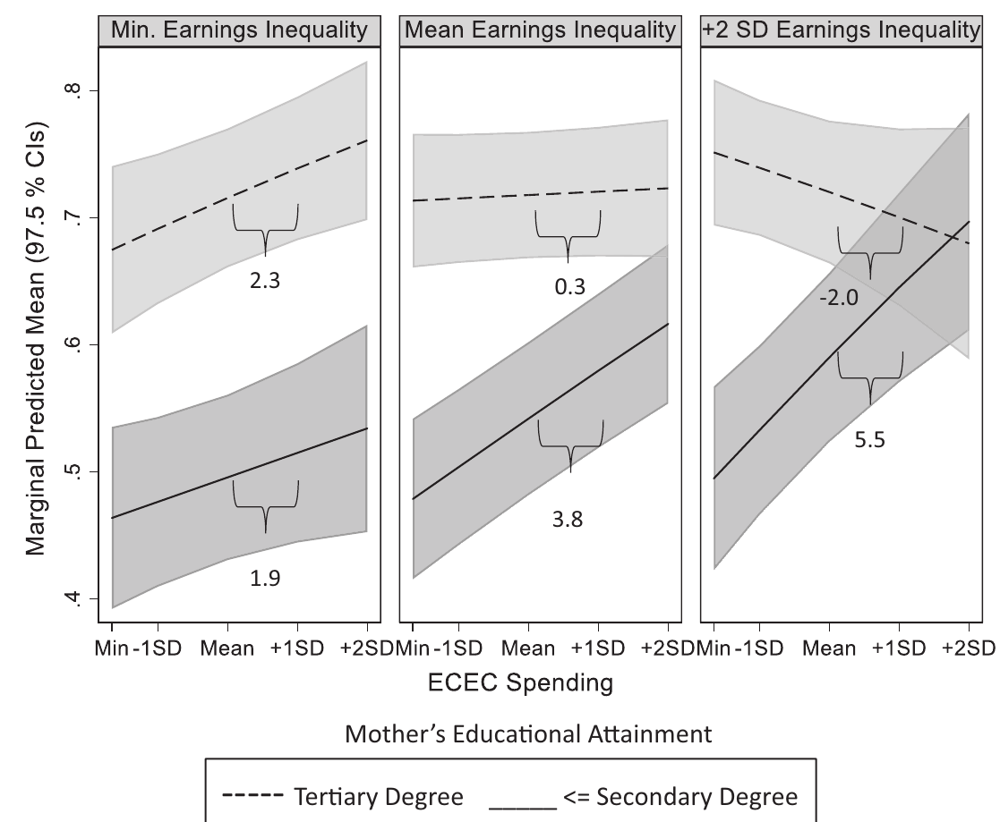{fig-align="center" height="500"}

::: {.notes}
Probabilidad predicha de empleo según el gasto en cuidado temprano (eje horizontal), para madres con educación terciaria (línea punteada) y secundaria o menos (línea continua), en tres niveles de desigualdad salarial. Los números indican el cambio en puntos porcentuales por una desviación estándar más de gasto. Con la desigualdad mínima, el efecto es parecido en ambos grupos (2,3 y 1,9). En la desigualdad promedio, el efecto es casi nulo para las madres universitarias (0,3) y de 3,8 para las demás. Con alta desigualdad (+2 DE), el efecto llega a 5,5 para las madres con menos educación y es negativo para las universitarias (−2,0), aunque con intervalos amplios. La brecha educativa en el empleo materno se cierra donde hay más gasto en cuidado temprano, especialmente en países desiguales.
:::

## {.center}

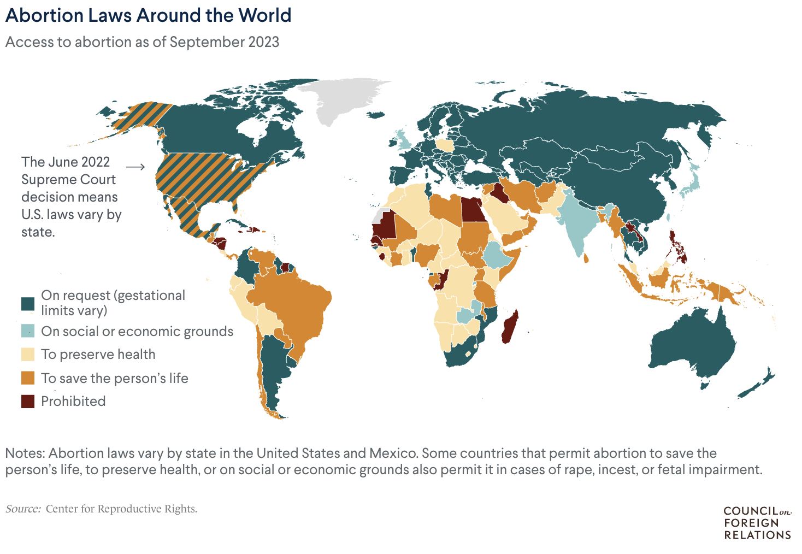{fig-align="center" height="620"}

## Efectos de la legalización del aborto en EE.UU. {.compact}

[(Myers & Welch 2021; actualizado)]{.cite}

-   Menos nacimientos (−4% a −11%) y menos maternidad adolescente (−34%).
-   Reducción de 30–50% en la mortalidad materna de mujeres no blancas.
-   Más educación, participación laboral, prestigio ocupacional e ingresos, sobre todo de mujeres afroamericanas.
-   Ser rechazada al solicitar un aborto aumenta la deuda vencida (+78%) y los desalojos, quiebras y juicios (+81%).

::: {.notes}
Fuentes, revisadas en octubre de 2026. Los hallazgos siguen siendo consistentes con la literatura actual; no encontré estudios que los refuten.

Nacimientos: reducción de 4% a 11% en los estados que legalizaron antes de Roe, con efectos casi tres veces mayores para adolescentes y mujeres de color (Levine, Staiger, Kane y Zimmerman 1999). Maternidad adolescente: −34% de madres adolescentes y −20% de adolescentes casadas, con efectos mayores para jóvenes afroamericanas (Myers 2017, Journal of Political Economy).

Mortalidad materna: la versión publicada (Farin, Hoehn-Velasco y Pesko 2024, AEJ: Economic Policy) estima una reducción de 30–50% en la mortalidad materna de mujeres no blancas (134 muertes evitadas en el primer año), con poco efecto en mujeres blancas. La versión de trabajo de 2021, que cita Myers y Welch, decía 30–40%. El estudio mide mujeres "no blancas", no específicamente afroamericanas. El efecto fue mayor en condados con menos médicos.

Educación, trabajo e ingresos (Angrist y Evans 1996; Kalist 2004; Lindo, Pineda-Torres, Pritchard y Tajali 2020; Jones 2021): es la evidencia menos directa. Los efectos son más claros para mujeres afroamericanas, y toda esta literatura usa la variación de los años setenta, cuando las tecnologías reproductivas y la vida de las mujeres eran distintas (advertencia de los propios Myers y Welch).

Deuda: Miller, Wherry y Foster, publicado en 2023 en AEJ: Economic Policy (la versión de trabajo era de 2020). Vinculan el Turnaway Study con registros de crédito y comparan a mujeres justo por debajo y justo por encima del límite gestacional de cada clínica. La deuda con 30 o más días de atraso aumenta 78% (unos 1.746 dólares) y los registros públicos negativos 81%, con efectos que persisten al menos cinco años. Limitación: es una muestra de mujeres que llegaron a una clínica (2008–2010), no la población general.
:::

## Evidencia reciente: después de *Dobbs* y en América Latina {.compact}

-   Las prohibiciones post-*Dobbs* aumentaron los nacimientos **2,3%** (Dench, Pineda-Torres & Myers 2024).
-   La mortalidad infantil fue **5,6%** mayor de lo esperado en estados con prohibición; **11%** en bebés afroamericanos (Gemmill et al. 2025).
-   Ciudad de México (2007): la legalización redujo la **morbilidad materna** (Clarke & Mühlrad 2021).
-   Uruguay (2012): evidencia **mixta** sobre la fecundidad adolescente.

::: {.notes}
Dench, Pineda-Torres y Myers (2024, Journal of Public Economics): diseño de diferencias en diferencias sintético, preregistrado. Los nacimientos aumentaron 2,3% en los estados con prohibiciones (unos 32.000 nacimientos adicionales al año), con efectos mayores para mujeres hispanas (4,7%) y de 20 a 24 años (3,3%), y en estados donde viajar a otro estado es más costoso (Texas 5,1%, Mississippi 4,4%). Implica que entre un quinto y un cuarto de quienes buscaban un aborto no lo obtuvo. Un estudio posterior (Economic Inquiry 2026) estima un efecto algo menor (1,6%).

Gemmill et al. (2025, JAMA), con un estudio compañero sobre fecundidad (Bell et al. 2025, JAMA): en 14 estados con prohibición total o a las seis semanas, unas 478 muertes infantiles más de lo esperado entre 2012 y 2023, la mayoría en Texas, que prohibió antes. Aumentaron las muertes por anomalías congénitas. Bell et al. estiman unos 22.000 nacimientos adicionales, concentrados en mujeres racializadas, beneficiarias de Medicaid, jóvenes y sin título universitario. Limitación: son estimaciones de corto plazo y algunos subgrupos son pequeños.

América Latina. Clarke (Universidad de Santiago de Chile) y Mühlrad (2021, Journal of Health Economics), con registros administrativos de salud de todo México: la despenalización y el subsidio del aborto temprano en el entonces Distrito Federal (2007) redujeron fuertemente la morbilidad materna, sobre todo las hemorragias en el embarazo temprano; aumentar las sanciones en otros estados tuvo efectos pequeños o nulos. Uruguay (legalización hasta las 12 semanas, 2012): Antón, Ferre y Triunfo (2018, Health Economics) no encuentran efectos en la fecundidad adolescente, mientras que Cabella y Velázquez (2022, Studies in Family Planning) encuentran una reducción de alrededor de 4% en la tasa de fecundidad adolescente; las diferencias se deben a período, cobertura geográfica y fuentes de datos.

Pregunta posible: ¿qué nos dicen estos efectos sobre el Estado como institución generizada? Las políticas sobre aborto distribuyen costos de manera desigual según raza, clase y territorio (conexión con Acker 2006 y con Hook y Paek 2020). En Chile, la ley de 2017 despenalizó el aborto en tres causales.
:::

## Discusión liderada por Candela y Trajan {background-image="img/C4/portada.jpg" background-size="cover" background-opacity="0.35" .center}

{.nostretch style="width:160px; margin:0;"}
