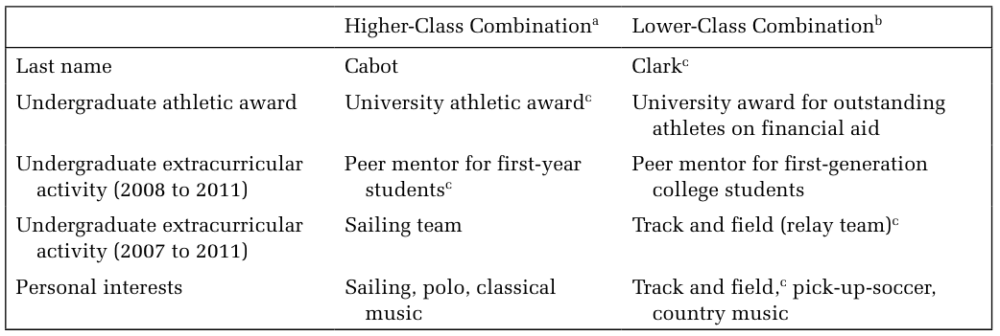
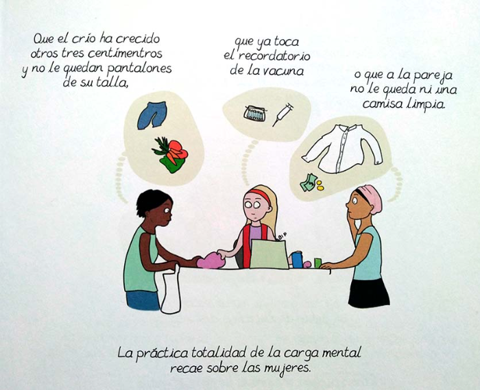
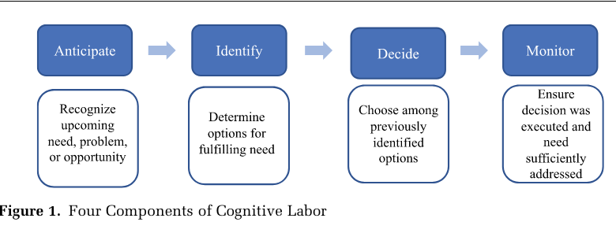
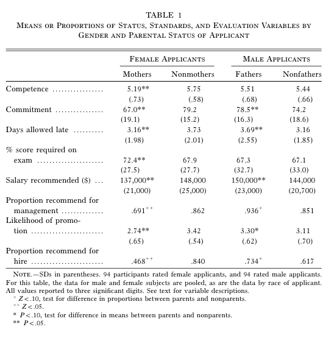
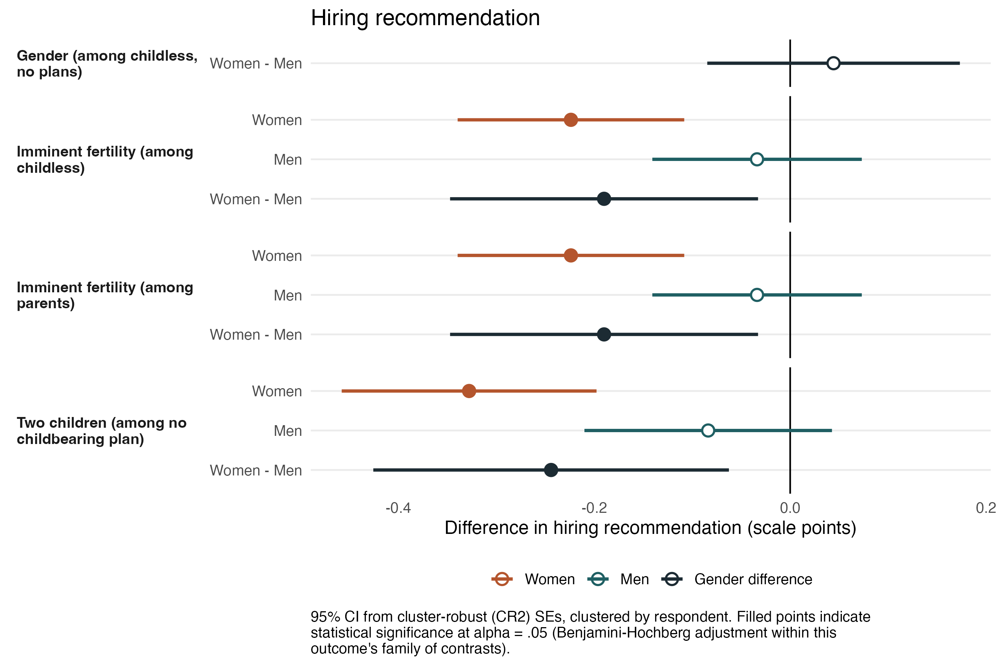
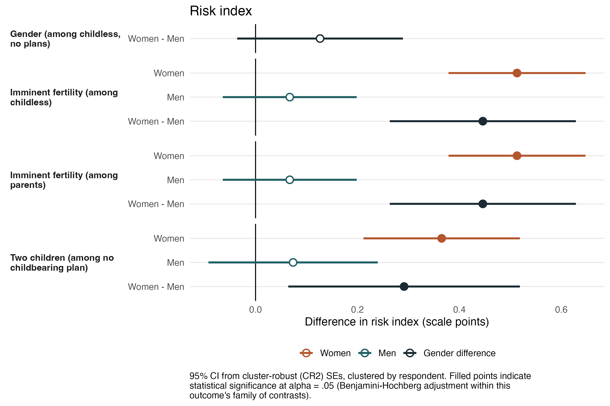
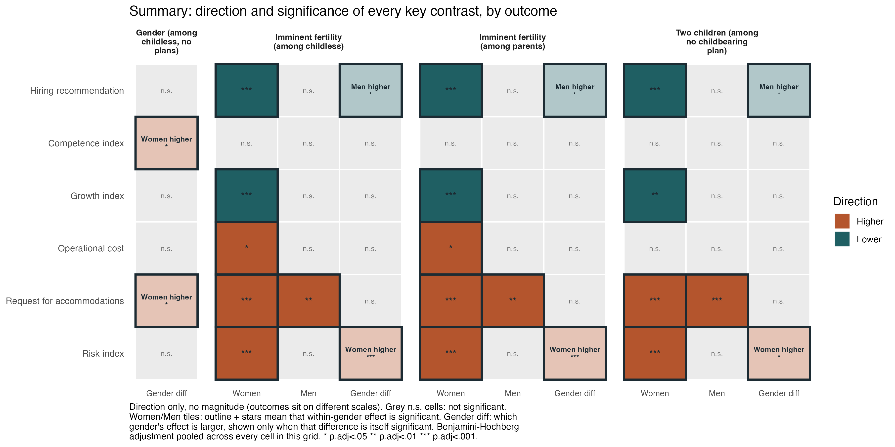

## Hilo de la clase

::::: {.process}

::: {.step}
<h4>Trabajo no remunerado</h4>

Familia, división del trabajo y carga mental.
:::

::: {.arrow}
→
:::

::: {.step}
<h4>Expectativas del empleador</h4>

Selección, estereotipos y castigo a la maternidad.
:::

::: {.arrow}
→
:::

::: {.step}
<h4>Salarios</h4>

Brecha salarial y segregación.
:::

:::::

::: {.notes}
El hilo de la clase: lo que ocurre dentro de los hogares (quién hace el trabajo de cuidado y quién piensa en él) condiciona lo que los empleadores esperan de hombres y mujeres, y esas expectativas se traducen en acceso al empleo, salarios y trayectorias. Es la continuación de la clase 4: Acker (2006) mostró que el trabajo se organiza en torno a un trabajador ideal sin responsabilidades de cuidado; hoy vemos cómo operan esos supuestos en la contratación y en los salarios, y qué es específico del caso chileno.
:::

# Familia

## ¿Qué es la familia?

[(Cohen, *The Family: Diversity, Inequality, and Social Change*)]{.cite}

**Personal**

Quiénes considero mi familia.

**Legal**

La que reconoce el Estado.

**Institucional**

Normas y prácticas que organizan reproducción, cuidado y recursos.

-   Estudiar juntas la **diversidad** de familias y la **desigualdad** que las atraviesa.

::: {.notes}
Phil Cohen propone tres maneras de definir la familia. La familia personal es la que cada persona reconoce como propia (puede incluir amistades cercanas o excluir parientes). La familia legal es la que reconoce el Estado: matrimonio, filiación, adopción, y define derechos como herencia, licencias o beneficios de salud. La familia como institución es un conjunto de normas y prácticas socialmente organizadas que regulan la reproducción, el cuidado y la distribución de recursos. Esta última definición es la que conecta con el curso: como las organizaciones de Acker (clase 4), la familia es una institución generizada.

El énfasis de Cohen es estudiar a la vez la diversidad de formas familiares y la desigualdad (de género, clase, raza) que las atraviesa, en lugar de partir de un modelo único de "la familia". Dejamos fuera su trabajo empírico sobre matrimonio y estructura familiar, que es muy específico de EE.UU. (Verificar las definiciones en el capítulo 1 de la edición disponible.)

Pregunta posible: en Chile, ¿qué familias reconoce la ley y cuáles no? Por ejemplo, el Acuerdo de Unión Civil (2015) y el matrimonio igualitario (2021).
:::

## La familia como institución generizada

-   La familia y el trabajo remunerado como **instituciones avaras**: compiten por el mismo tiempo y lealtad.
-   **Maternidad intensiva**: la crianza debe ser absorbente, centrada en los hijos y realizada por las madres.
-   En América Latina, las políticas **maternalistas** asignan el cuidado a las madres.

::: {.notes}
Instituciones avaras (*greedy institutions*): concepto de Lewis Coser (1974). Son instituciones que demandan dedicación total y exclusiva; la familia y el trabajo remunerado compiten por el tiempo, la energía y la lealtad de las personas, y esa competencia recae sobre todo en las mujeres.

Maternidad intensiva: Sharon Hays (1996), *The Cultural Contradictions of Motherhood*. La ideología dice que la crianza debe tomar mucho tiempo, energía y recursos, debe ser prioridad sobre otros intereses, estar guiada por expertos y ser realizada por las madres. La contradicción cultural que señala Hays: esta ideología exige altruismo y entrega total justo cuando el mercado laboral exige una lógica individualista de maximización. Las madres que trabajan quedan atrapadas entre ambas exigencias.

Maternalismo: Blofield y Martínez (2014, lectura complementaria de la clase 4) distinguen políticas maternalistas, que refuerzan el rol de las madres como cuidadoras, de políticas de corresponsabilidad. En Chile, la sala cuna ligada a las trabajadoras y las licencias centradas en las madres son ejemplos de maternalismo, y conectan con el experimento chileno que veremos más adelante.
:::

## ¿Por qué persiste la división desigual?

-   **Especialización:** el hogar es más eficiente si cada uno se especializa.
-   **Tiempo y recursos relativos:** quien gana más o trabaja más horas negocia hacer menos.
-   **Hacer género:** el trabajo doméstico también es una forma de **demostrar** el género.

::: {.box .box-q}
Si fuera solo intercambio económico, ¿por qué los hombres que dependen económicamente de sus parejas no hacen más trabajo doméstico?
:::

::: {.notes}
Tres familias de explicaciones.

Especialización (Gary Becker, *A Treatise on the Family*, 1981): el hogar maximiza su bienestar si cada integrante se especializa en el trabajo en que tiene ventaja comparativa. La crítica feminista: la "ventaja comparativa" de los hombres en el mercado es en parte producto de la discriminación y la segregación; el modelo naturaliza la desigualdad y no explica por qué la especialización sigue la línea de género incluso cuando las mujeres ganan más.

Tiempo disponible y recursos relativos (enfoque de negociación): quien tiene más horas de trabajo remunerado tiene menos tiempo para el doméstico, y quien aporta más ingresos tiene más poder de negociación para evitar el trabajo doméstico, que es poco valorado.

Hacer género (gender display): Julie Brines (1994, *American Journal of Sociology*) encontró que, entre los hombres económicamente dependientes de sus esposas, el trabajo doméstico no aumenta como predice el intercambio, e incluso disminuye: hacer menos trabajo doméstico sería una forma de compensar una posición que amenaza la masculinidad. Conecta con West y Zimmerman (clase 3): la división del trabajo no solo refleja el género, también lo produce. La evidencia sobre esta "compensación" es debatida (por ejemplo, depende de cómo se mide y de qué hombres se trata), lo que es un buen punto de discusión.
:::

## La "revolución estancada"

-   **Tradicionalista**, **neo-tradicionalista**, **igualitaria**: las **actitudes** se volvieron más igualitarias que las **prácticas**.
-   Cambio **asimétrico**: las mujeres entraron al trabajo remunerado, pero los hombres no entraron en la misma medida al cuidado.
-   La desigualdad se desplaza a lo menos visible: la **carga mental**.

::: {.notes}
Tres ideologías de división del trabajo en parejas. Tradicionalista: los hombres deben ser responsables de proveer económicamente y las mujeres del trabajo de cuidado. Neo-tradicionalista: los hombres se enfocan en el trabajo y las mujeres pueden trabajar si quieren, pero solo si no interfiere con su "real" trabajo de cuidar a su familia. Igualitaria: división relativamente simétrica entre ambos tipos de trabajo.

La "revolución estancada" viene de Arlie Hochschild (*The Second Shift*, 1989): las mujeres que trabajan de forma remunerada cumplen una "segunda jornada" en casa, y la revolución de género se estancó porque los hombres y las instituciones no cambiaron al mismo ritmo. Paula England (2010, "The Gender Revolution: Uneven and Stalled", *Gender & Society*) explica la asimetría: las mujeres tienen incentivos para entrar a actividades masculinas, más valoradas, pero los hombres tienen pocos incentivos para entrar a actividades femeninas, devaluadas. Por eso el cambio fue desigual.

Barreras para la división igualitaria: institucionales (instituciones avaras, políticas que restringen beneficios o responsabilidades por género) e ideológicas (maternidad intensiva, normas de género). Junto con la desigualdad en el mercado laboral, esto lleva a la especialización pese a aspiraciones igualitarias. La última viñeta es el puente hacia Daminger (2019): aunque la decisión se comparta, la anticipación y el monitoreo siguen recayendo en las mujeres.
:::

## Estereotipos de ma-paternidad

-   Los estereotipos y representaciones en medios sobre la ma-paternidad son *gendered*: la madre 100% dedicada y experta, el padre incompetente e inútil.
-   Se ven en medios, películas, redes sociales, etc.

[Video 1](https://www.youtube.com/watch?v=jHPbOGEUvZA) · [Video 2](https://www.youtube.com/watch?v=jyMZ_LOVcvo)

# Trabajo remunerado

## Género y clase en un mercado laboral de élite

[(Rivera & Tilcsik 2016)]{.cite}

-   Estudio de correspondencia en estudios de abogados.
-   Postulantes recién graduados de la universidad.
-   Manipulación experimental de **género** (nombre) y **clase** (señales en el currículum):

{fig-align="center" width="75%"}

::: {.notes}
Rivera y Tilcsik (2016, American Sociological Review). Enviaron solicitudes de estudiantes ficticios de escuelas de derecho selectivas pero no de élite a 316 oficinas de grandes estudios de abogados en 14 ciudades de EE.UU., asignando aleatoriamente señales de clase y género a currículos por lo demás idénticos. La clase se señaló con el apellido y actividades extracurriculares (premio deportivo, mentoría, deportes como navegación o atletismo, intereses personales). Lo que se mide es la tasa de "callback", es decir, la invitación a entrevista.
:::

## Principales resultados

-   Los hombres de clase alta reciben una tasa de respuesta **cuatro veces mayor** que el promedio de los demás postulantes.
-   La clase alta aumenta la probabilidad de entrevista, **pero solo para los hombres**.
-   En la encuesta experimental, los hombres de clase alta **no** son evaluados como más competentes ni más cálidos: se descartan esos dos mecanismos.

::: {.notes}
Cifras del artículo: el postulante hombre de clase alta tuvo una tasa de respuesta de 16,25%, más de cuatro veces la de las demás combinaciones (la de mujeres de clase baja, por ejemplo, fue de 3,83%). La clase social no es una categoría protegida, por lo que casi no hay datos que permitan estudiar la discriminación por clase en la contratación.
:::

## Las mujeres de clase alta: "poco compromiso"

-   Las mujeres de clase alta son evaluadas como **menos comprometidas** con la carrera que los hombres de clase alta y que las mujeres de clase más baja.
-   Las señales de clase alta se asocian con mejor **"fit"** cultural con la empresa, que aumenta la recomendación de entrevista.
-   Mujeres de clase baja: buena ética de trabajo pero **mal fit**.
-   Mujeres de clase alta: fuertes académica y profesionalmente, pero con **bajo compromiso**: se teme que no duren porque tendrán el privilegio económico de no hacerlo.

## Cómo se contrata en Chile

[(Undurraga 2019)]{.cite}

-   **43 entrevistas** con gerentes, consultores de recursos humanos y postulantes en Santiago; seis etapas del proceso de selección.
-   El "fit" se filtra por **idiomas, colegio, universidad, comuna** y apellido.
-   Se pregunta por estado civil, pareja e hijos; se usan **tests proyectivos** (p. ej., Rorschach) sin evidencia de validez.
-   Discurso de **meritocracia** que esconde **discriminación explícita**.

::: {.notes}
Undurraga (2019, Bulletin of Latin American Research) problematiza el discurso dominante de meritocracia, transparencia y excelencia en un país muy neoliberal y desigual, con servicios externos de selección (headhunters, Servicio Civil) y medidas "objetivas" de las capacidades. Analiza seis etapas del proceso, y muestra desde la definición del cargo cómo operan las categorías: en español el lenguaje es genérico masculino ("el gerente"), y las descripciones de cargo incluyen requisitos como idiomas, universidad, colegio y lugar de residencia. Una reclutadora lo dice así: las empresas de élite piden idiomas, que es un filtro de clase, y luego filtran por distrito y barrio. Los "soft skills" y palabras como "confiable" funcionan como eufemismos de contactos sociales y origen. En una encuesta citada, 70,7% cree que un apellido mapuche puede perjudicar.

Después del filtro de currículos, lo más común es la evaluación psicolaboral, que incluye entrevistas por competencias, pruebas psicométricas y proyectivas (Rorschach, e incluso grafología en algunos casos), cuya validez predictiva no está respaldada por evidencia. En las entrevistas se pregunta por la pareja, los hijos, sus edades y sus colegios; si el currículo dice "casada", se pregunta con quién. También hay heteronormatividad: la heterosexualidad facilita el ingreso y la homosexualidad puede perjudicar; el estado civil se correlaciona con la edad ("ni muy viejo ni muy joven"). Para detalles de cada eje, volver al texto.
:::

## Dos formas de mirar la contratación

**Rivera y Tilcsik (2016)**

Experimento de correspondencia: **causal**, aísla el efecto de género y clase en la invitación a entrevista. Dice *qué* pasa, pero no *cómo*.

**Undurraga (2019)**

Entrevistas: **mecanismos** y discurso de quienes contratan. Dice *cómo* se justifica, pero no mide el efecto.

::: {.box .box-q}
Si el "fit" es el mecanismo, ¿qué diría un reclutador chileno sobre una candidata de clase alta que "no se compromete"?
:::

::: {.notes}
Los dos estudios son complementarios. Rivera y Tilcsik identifican causalmente que la clase alta solo ayuda a los hombres y que las mujeres de clase alta son leídas como poco comprometidas; las entrevistas con abogados explican el mecanismo (fit cultural y compromiso). Undurraga muestra, en Chile y con postulantes y reclutadores reales, que el "fit" se define explícitamente con indicadores de clase (colegio, comuna, idiomas), de género (estado civil e hijos) y de sexualidad. Combinados, permiten plantear qué haría falta para un estudio de correspondencia en Chile y cuáles serían las señales relevantes de clase (colegio, comuna, apellido).
:::

# Trabajo doméstico y carga mental

## Carga mental

::::: {.columns}
::: {.column width="50%"}
{fig-align="center"}
:::
::: {.column width="50%"}
{fig-align="center"}
:::
:::::

## La dimensión cognitiva del trabajo doméstico

[(Daminger 2019)]{.cite}

{fig-align="center" width="85%"}

-   **Invisible** para otras personas, y a veces para quien lo hace.
-   Difuso: cuesta registrarlo y cuantificarlo.

::: {.notes}
Características del trabajo cognitivo: invisible para otras personas; invisible a veces para la misma persona que lo hace, porque es parte de cómo pensamos y operamos (hábitos); es difuso o abstracto y cuesta registrarlo o cuantificarlo; no tiene límite de espacio ni de tiempo para hacerse, interrumpiendo el tiempo de ocio y el trabajo remunerado.

Daminger (2019, ASR): 70 entrevistas en profundidad a integrantes de 35 parejas. El trabajo cognitivo tiene cuatro componentes: anticipar necesidades, identificar opciones, decidir y monitorear.
:::

## Diferencias de género en el trabajo cognitivo

[(Daminger 2019)]{.cite}

-   Las mujeres hacen **más trabajo cognitivo** en general, y más de la **anticipación** y el **monitoreo**.
-   La participación en la **decisión** es aproximadamente igual.
-   Fuente frecuente de **conflicto** en las parejas.

::: {.notes}
Varias parejas muestran un patrón de desequilibrio de género en la anticipación y (menos frecuentemente) en la identificación, seguido de colaboración en la etapa de decisión. Ejemplo del texto: Jenna y Peter acuerdan inscribir a su hija en una clase de música, pero fue Jenna quien encontró la clase y alertó a Peter. La decisión, que es el componente más ligado al poder y la influencia, es el más igualitario; el trabajo invisible y continuo recae en ellas.
:::

# Maternidad y mercado laboral

## Castigo a la maternidad en salarios en Latinoamérica

[(Villanueva & Lin 2019)]{.cite}

-   Castigo a la maternidad en cinco países: desde **12% en Brasil** a **21% en Chile** (el más alto).
-   La participación de las madres en el **trabajo informal** explica parte del castigo.
    -   Pero **no en Chile**: la maternidad no es un determinante tan importante del trabajo informal como en otros países.

::: {.notes}
Nota: los datos son anteriores a la pandemia, cuando la informalidad laboral de las mujeres aumentó bastante. El estudio usa 43 encuestas de hogares (2000–2017) de Argentina, Brasil, Chile, México y Perú, controlando por selección al empleo y capital humano.
:::

## Qué explica (y qué no) el castigo en Chile

[(Villanueva & Lin 2019)]{.cite}

-   Chile tiene la penalización **más alta** y es el **único** país donde la informalidad no la explica.
-   Los autores lo atribuyen a la **baja participación femenina** y a un sector informal pequeño.
-   ¿Es el 21% una penalización de las madres, o de las pocas madres que **permanecen** trabajando?

::: {.notes}
Tres puntos críticos. (1) Selección: si en Chile pocas madres de nivel socioeconómico bajo participan en el mercado laboral, la comparación se hace entre madres y mujeres sin hijos muy seleccionadas, y la cifra puede reflejar quiénes se quedan trabajando más que el castigo en sí. El estudio ajusta por selección al empleo, pero la pregunta de interpretación sigue abierta. (2) "Explicar" con informalidad: el hallazgo puede significar que la maternidad empuja a las mujeres a empleos informales (efecto de la maternidad sobre dónde se trabaja) o que las mujeres con peores opciones previas se concentran allí. (3) Contraste con Correll et al. (2007): ese estudio identifica discriminación del empleador, y Villanueva y Lin identifican estructura del mercado (informalidad). ¿Son explicaciones rivales o complementarias? En Argentina, los autores especulan que los sindicatos protegen a trabajadores formales y empujan a las madres al sector informal. Los datos son anteriores a la pandemia.
:::

## Castigo a la maternidad en contrataciones en EE.UU.

[(Correll et al. 2007; Ishizuka 2021)]{.cite}

{fig-align="center" height="520"}

::: {.notes}
Ishizuka (2021): la presión de tiempo, la colaboración y las exigencias de viaje son más comunes en avisos de empleos profesionales y gerenciales, mientras que los horarios no estándar y la inestabilidad de horarios son más comunes en avisos de servicios de bajos salarios. Los empleadores discriminan más a las madres en empleos profesionales y gerenciales cuando la presión de tiempo, la colaboración y el viaje son requisitos explícitos. En cambio, discriminan de manera similar a las madres en empleos de servicios de bajos salarios sin importar si el aviso exige horarios no estándar, pero la inestabilidad de horarios predice una discriminación más fuerte.
:::

## Sesgos asociados a la maternidad (EE.UU.)

-   El foco tiende a estar en la **maternidad**, con impactos en participación laboral, salarios y oportunidades.
-   ¿Se extiende la penalización a mujeres que **no son madres**?
-   Las mujeres podrían ser afectadas solo por la **expectativa** de que serán madres en el futuro.

::: {.notes}
Estudio diseñado para medir estereotipos en contextos de selección y evaluación de personas, para ver cómo son percibidas las mujeres que no son madres pero podrían ser consideradas "futuras madres".
:::

## Maternidad actual y potencial en Chile: el estudio {.compact}

[(Cabello-Hutt, en proceso; resultados preliminares)]{.cite}

-   Experimento factorial con **1.449 supervisores/as** en Chile que evalúan perfiles ficticios de postulantes a una vacante.
-   Los perfiles varían **género**, estado civil, **situación parental** (0, 1 o 2 hijos/as), **planes familiares** (en 2 años, en 5 años, no desea), experiencia y desempeño.
-   Resultados: **evaluación** (contratación), **competencia**, **crecimiento**, **costo** y **riesgo**.
-   Contexto **maternalista**: licencia extensa para madres, casi sin licencia de paternidad y sala cuna ligada a las trabajadoras.

::: {.notes}
Estudio prerregistrado en AsPredicted. Los experimentos conjoint permiten testear causalmente el efecto de cada atributo del perfil, manteniendo constantes todos los demás. La fertilidad potencial se señalizó mediante el atributo de planes familiares, cruzado con la situación parental; así se separa la maternidad actual de la fertilidad anticipada. Variables de resultado: evaluación (contratación, buena inversión); competencia (capaz, confiable); crecimiento (prometedora, ambiciosa, promovida); costo (costosa, solicita facilidades, usa beneficios); riesgo (compromiso a largo plazo, ausentarse, renunciar). Las dos ocupaciones (profesional y técnica) no moderan los efectos principales, así que los resultados son de la muestra agrupada. A diferencia del estudio en EE.UU., este se sitúa en un contexto de políticas maternalistas.

Actividad posible antes de mostrar los resultados: pedir predicciones. ¿En qué dimensiones serían penalizadas las mujeres con planes de tener hijos en dos años? ¿Los hombres con los mismos planes? ¿Hay diferencias entre madres y no madres?
:::

## Resultado: recomendación de contratación

{fig-align="center" height="560"}

::: {.notes}
La recomendación de contratación se reduce por fertilidad inminente y por maternidad con dos hijos/as, pero no por el género solo ni por un primer hijo/a. Ambas penalizaciones son específicas de las mujeres: para los hombres, ni declarar planes inminentes ni tener hijos modifica la recomendación. Resultados preliminares.
:::

## Resultado: índice de riesgo

{fig-align="center" height="560"}

::: {.notes}
Las mujeres son evaluadas como más riesgosas por fertilidad inminente, con o sin hijos/as, y por maternidad con dos hijos/as. El riesgo percibido de los hombres es estable independientemente de las señales familiares. En esta dimensión, cada diferencia de género es estadísticamente significativa. Dato clave: la competencia nunca es penalizada, lo que desafía la explicación clásica basada en estatus (Correll et al. 2007). Resultados preliminares.
:::

## Resumen de resultados preliminares

{fig-align="center" height="540"}

::: {.notes}
Solo dirección y significancia, no magnitud: las variables de resultado están en escalas distintas. Columna 1, género sin señal familiar: casi vacía; sin información familiar no hay brecha en contratación. Columnas 2 y 3, fertilidad inminente entre mujeres sin hijos y entre madres: casi idénticas; no importa si ya tiene hijos/as. Cada fila se activa excepto competencia. Columna 4, dos hijos/as sin planes de más: misma forma pero sin costo operacional; la maternidad no aumenta el costo percibido, la maternidad anticipada sí. La fila de facilidades es la única donde los hombres también son penalizados. Tres hallazgos: (1) el género solo no penaliza la contratación, (2) la fertilidad inminente penaliza por igual a madres y no madres, (3) la maternidad actual penaliza desde el segundo hijo/a.
:::

## La asimetría clave

-   Las señales familiares aumentan el uso esperado de **facilidades** para mujeres **y** hombres.
-   Pero las consecuencias negativas (costo, menor crecimiento, riesgo) recaen **solo sobre las mujeres**.
-   En Chile, las políticas vinculan licencias y beneficios **primordialmente a las madres**.

::: {.box .box-q}
Si la competencia no es penalizada, ¿es más efectivo cambiar percepciones o cambiar las políticas?
:::

::: {.notes}
Forma más precisa de enunciar el resultado de género: no es que los empleadores no noten que los hombres tienen familias, sino que solo para las mujeres una demanda anticipada se convierte en costo, riesgo y menor potencial. Las políticas maternalistas chilenas refuerzan esto: sala cuna vinculada a trabajadoras, licencia de paternidad de 5 días frente a 6 meses de licencia para madres, y entre 2011 y 2016 solo el 0,24% de los hombres elegibles usó el postnatal parental. Conecta con el debate actual sobre sala cuna universal y postnatal compartido, y con la crítica de Acker (2006) a las políticas de conciliación que refuerzan el modelo masculino de organización. Comparación con EE.UU.: allá la maternidad futura se penalizó solo en costo y riesgo, y la maternidad actual además en crecimiento y competencia; en Chile la competencia no es penalizada en ningún caso.
:::

# Brecha salarial

## Video sobre la brecha salarial

Para discusión: ¿qué supuestos sobre **discriminación** y **elección** hace cada argumento del video?

## Brecha salarial en Chile

[(Cruz & Rau 2022)]{.cite}

-   Datos administrativos: brecha salarial de **24%**, pero heterogénea.
-   Por tamaño de empresa: hasta 10 trabajadores, **8%**; 200 o más, **36%**.
-   Por sector: financiero, **9%**; minería, **48%**.
-   **82–92%** de la brecha se debe a que las mujeres están subrepresentadas en empresas que pagan salarios altos y sobrerrepresentadas en las que pagan bajos.
-   **8–18%** se debe a diferencias entre hombres y mujeres con igual educación y habilidad en las mismas empresas.

::: {.box .box-q}
Si la mayor parte de la brecha es **segregación entre empresas**, ¿es discriminación o "elección"? ¿Quién decide a qué empresas llegan las mujeres?
:::

::: {.notes}
Preguntas para cerrar el bloque. El 82–92% de la brecha se explica por dónde trabajan hombres y mujeres, no por lo que se les paga dentro de una misma empresa. Pero la distribución entre empresas es el resultado de procesos de selección (Undurraga, Rivera y Tilcsik), de expectativas sobre maternidad (experimento chileno) y de la carga de cuidado (Daminger, ENUT): es el mismo debate de "oferta y demanda" de Ridgeway y Correll (clase 3), donde las "elecciones" están socialmente construidas. Brecha bruta vs. ajustada: la cifra depende de qué se controla.
:::
