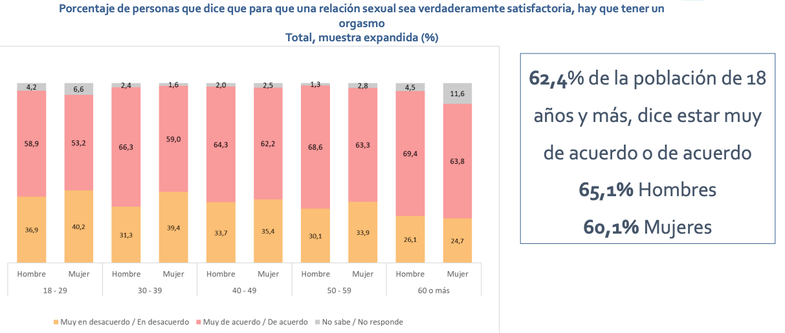

## La sexualidad como sistema de normas

[(Gagnon & Simon 1973; Risman 2004)]{.cite}

::::: {.process}

::: {.step}
<h4>Individual</h4>

Guiones **intrapsíquicos**: lo que deseo y me permito desear.
:::

::: {.arrow}
→
:::

::: {.step}
<h4>Interaccional</h4>

Guiones **interpersonales**: quién propone, quién responde, qué "cuenta" como sexo.
:::

::: {.arrow}
→
:::

::: {.step}
<h4>Cultural e institucional</h4>

**Escenarios culturales**: escuela, medios, religión, leyes y también las **encuestas**.
:::

:::::

-   La sexualidad no es un impulso natural que se expresa solo: se **aprende** y se **vigila**.

::: {.notes}
Tiempo: 3 min. Eje de la clase: la sexualidad como un sistema de normas que opera en los tres niveles del modelo multinivel (Risman 2004, clase 2 y clase 5). Gagnon y Simon (1973, *Sexual Conduct*) proponen que la conducta sexual se aprende como un guion: no hay un impulso "natural" que se expresa solo, sino conductas que adquieren sentido según libretos sociales. Sus tres niveles calzan con los de Risman: los escenarios culturales (qué es normal, deseable o vergonzoso), los guiones interpersonales (cómo se coordina una interacción sexual) y los guiones intrapsíquicos (lo que cada persona desea).

Cómo se ubican las lecturas en el eje: Benavente y Vergara (2006) muestran cómo se construye la sexualidad de hombres y mujeres en Chile, con el cuerpo masculino "para sí" y el femenino "para otro" (nivel individual y cultural). Miller (2016) muestra la vigilancia entre pares en la escuela: rumores, *slut-shaming* y etiquetas homofóbicas como "drama sexual" en un contexto escolar que limita la información sexual (nivel interaccional e institucional). Pfeffer (2014) muestra qué pasa cuando las categorías no calzan (diapositiva 3). Hoy no resumimos las lecturas: nos enfocamos en ideas que las atraviesan, y la discusión liderada profundiza en ellas.
:::

## Cuerpo para sí, cuerpo para otro

[(Benavente & Vergara 2006)]{.cite}

**Hombres: cuerpo para sí**

Ejercer la sexualidad reafirma la hombría; experiencia y placer como algo natural.

**Mujeres: cuerpo para otro**

Menstruación como inicio del riesgo; temor y vergüenza del cuerpo sexuado.

-   Lo masculino como **sujeto** de placer; lo femenino como **objeto** de placer.

::: {.notes}
Tiempo: 3 min. Benavente y Vergara (2006, FLACSO Chile, cap. I, pp. 40–45) entienden la sexualidad como construcción social: una capacidad física para la excitación y el placer, unos significados personales y socialmente compartidos que forman las identidades sexuales y de género, y una interpretación cultural de funciones "naturales" ordenadas en relaciones sociales jerárquicas.

Hombres (cuerpo para sí): ejercer la sexualidad es una manera de reafirmar la hombría; la sexualidad sin control se considera parte de la identidad de género; se espera que adquieran experiencia; la excitación física se ve como algo natural y el placer como parte de sus vidas.

Mujeres (cuerpo para otro): el discurso se centra en la menstruación y el cuidado del cuerpo; hay secreto y falta de información; la menstruación marca el inicio del riesgo y de la necesidad de cuidarse; aparecen el temor y la vergüenza del cuerpo sexuado.

Conexión con el eje de la clase: es la versión chilena de los guiones intrapsíquicos y de los escenarios culturales. Anticipa el imperativo del coito (siguiente diapositiva) y la justicia íntima (si el cuerpo de las mujeres es "para otro", su satisfacción tiende a medirse por la del otro). Es una lectura mínima: la discusión puede profundizar en las diferencias por clase y edad que el libro también analiza.
:::

## Heteronormatividad y el imperativo del coito

[(McPhillips, Braun & Gavey 2001)]{.cite}

-   **Hetero- y mononormatividad:** se supone la heterosexualidad y la monogamia.
-   **Imperativo del coito:** el "sexo de verdad" es la penetración pene-vagina; todo lo demás "no cuenta".
-   Prioriza el **orgasmo masculino** y convierte la falta de deseo de las mujeres en "disfunción".
-   Los guiones asignan roles: él **toma la iniciativa**, ella **responde**.

::: {.notes}
Tiempo: 3 min. McPhillips, Braun y Gavey (2001, *Women's Studies International Forum*) analizan cómo hombres y mujeres heterosexuales en Nueva Zelanda definen el "sexo" en torno al coito. Como los hombres suelen tener orgasmo con la penetración y las mujeres muchas veces no, este guion prioriza el placer masculino; la dificultad o la falta de deseo de penetración se lee como un problema médico o individual, y no como un efecto de la norma. Junto con otras normas, esto contribuye a la "brecha del orgasmo" en relaciones heterosexuales. Los guiones también definen roles: masculino asertivo, que toma la iniciativa y empuja la interacción; femenino receptivo, paciente, que responde a la iniciativa de él. Conectar con Benavente y Vergara: lo masculino como sujeto de placer (activo) y lo femenino como objeto de placer.
:::

## Cuando las categorías no calzan

[(Pfeffer 2014)]{.cite}

-   Mujeres en pareja con **hombres trans** son leídas como **heterosexuales** por quienes las rodean.
-   Pfeffer reemplaza "*passing*" por **reconocimiento** (Connell): pertenecer a un grupo depende de cómo nos **leen** los demás.
-   El (des)reconocimiento revela más sobre el **privilegio normativo** que sobre las personas.

::: {.box .box-q}
Si la orientación sexual se infiere del género de la pareja, ¿qué pasa cuando ese género no se "ve" como se espera?
:::

::: {.notes}
Tiempo: 4 min. Pfeffer (2014, *American Journal of Sociology*): entrevistas en profundidad con 50 mujeres de EE.UU., Canadá y Australia que describen 61 relaciones con hombres trans. Muchas se identifican como queer o lesbianas, pero en la vida cotidiana son leídas como mujeres heterosexuales en parejas heterosexuales, lo que les da acceso a privilegios (por ejemplo, reconocimiento legal o social) y al mismo tiempo las invisibiliza dentro de sus comunidades.

El argumento teórico: Pfeffer propone ir más allá de dos enfoques, el del "passing" (que supone que hay una identidad "verdadera" que se oculta) y el de "nacer así" (*born this way*, la explicación biológica de la orientación sexual). Con la noción de reconocimiento de Connell, sostiene que los derechos, privilegios y pertenencia a grupos asociados al sexo, género y sexualidad dependen de la interpelación social: las identidades son logros interaccionales. Estas personas gestionan estratégicamente el (des)reconocimiento para acceder a beneficios de pertenencia. Las ansiedades sobre el "passing" se parecen a las ansiedades raciales por mantener el privilegio blanco.

Conexiones con el curso: con la clase 3, donde West y Zimmerman distinguen categoría de sexo (lo que se ve) y sexo (lo que se presume), y Westbrook y Schilt muestran que otros "determinan" nuestro género; con la clase 2, donde Ridgeway y Saperstein advierten que la diversificación de categorías no desarma necesariamente el sistema binario. La orientación sexual depende del género de la pareja, así que si se desestabiliza el género, se desestabiliza también la orientación.
:::

## ¿Qué mide una encuesta? ENSSEX 2022–2023

::::: {.columns}
::: {.column width="32%"}
-   Bienestar con la vida sexual (1–7): hombres **5,3**, mujeres **4,8**.
-   **62,4%** cree que, sin orgasmo, una relación sexual no es "verdaderamente satisfactoria".
-   La **pregunta** misma incorpora una norma.
:::
::: {.column width="68%"}
{fig-align="center"}
:::
:::::

::: {.notes}
Tiempo: 3 min. Encuesta Nacional de Salud Sexual (ENSSEX) del MINSAL, representativa de la población de 18 años y más (muestra de 20.392 personas según el material de pregrado; verificar contra el informe). Verificar también las cifras de bienestar: una versión anterior decía 5,08 nacional, 5,35 hombres y 4,83 mujeres; la prensa reporta 5,1, 5,3 y 4,8.

El punto analítico: las encuestas son parte de los escenarios culturales. Preguntar si "para que una relación sexual sea verdaderamente satisfactoria hay que tener un orgasmo" supone una definición de satisfacción centrada en el orgasmo y, en la práctica, en el coito. El 62,4% de acuerdo (65,1% hombres, 60,1% mujeres) es un dato sobre una norma, no sobre la biología. Pregunta para el grupo: ¿qué preguntas tendría una encuesta sobre sexualidad que no partiera del imperativo del coito?

Se eliminó la encuesta Gleeden que se usaba antes (aplicación de encuentros extramatrimoniales, muestra autoseleccionada): si se menciona, usarla como ejemplo de fuente poco confiable.
:::

## ¿Es biológica la "brecha del orgasmo"?

[(Frederick, St. John, Garcia & Lloyd 2018)]{.cite}

::: {style="font-size: 0.8em;"}
| Orgasmo "habitualmente o siempre" en el sexo con pareja | % |
|:--|:-:|
| Hombres heterosexuales | **95** |
| Hombres gays | 89 |
| Hombres bisexuales | 88 |
| Mujeres lesbianas | **86** |
| Mujeres bisexuales | 66 |
| Mujeres heterosexuales | **65** |
:::

-   Si la brecha fuera solo biológica, las lesbianas no estarían cerca de los hombres.

::: {.notes}
Tiempo: 3 min. Frederick, St. John, Garcia y Lloyd (2018, *Archives of Sexual Behavior*): encuesta en línea anónima publicada en el sitio de NBC News, con 52.588 personas adultas de EE.UU. La muestra no es probabilística (estuvo publicada diez días, sin marco muestral) y los autores no afirman que represente a la población. Lo robusto es la comparación entre grupos, no los porcentajes como estimación poblacional: es un buen ejemplo para discutir qué se puede concluir y qué no.

El argumento: la brecha no está entre hombres y mujeres, sino entre las mujeres según con quién tienen sexo. Esto apunta a los guiones (imperativo del coito, prácticas sexuales que se priorizan) y no al cuerpo. Armstrong, England y Fogarty (2012, *American Sociological Review*) encuentran algo parecido en universidades de EE.UU.: las mujeres tienen más orgasmos en relaciones que en encuentros casuales, en parte porque en las relaciones hay más prácticas que favorecen el orgasmo femenino, y por un doble estándar que cuestiona el derecho de ellas al placer en encuentros casuales.
:::

## Justicia íntima: la satisfacción no basta

[(McClelland 2010, 2014)]{.cite}

-   Lo que sentimos que **merecemos** depende de nuestra posición social.
-   Por eso la **satisfacción declarada** no mide igualdad.
-   Al responder, las mujeres asocian el extremo bajo de la escala con **dolor**; los hombres, con **no tener sexo**.

::: {.box .box-q}
Si hombres y mujeres dijeran estar igual de satisfechos, ¿habría igualdad sexual?
:::

::: {.notes}
Tiempo: 3 min. Sara McClelland (2010, *Social and Personality Psychology Compass*; 2014) propone el concepto de justicia íntima: incorporar el "derecho" y el merecimiento al estudiar la satisfacción sexual. En sus entrevistas, mujeres y hombres anclan de manera distinta los extremos de la escala: para muchas mujeres el punto más bajo es el dolor o la degradación, mientras que para los hombres es no tener sexo o no tener orgasmo. Las mujeres también califican alto cuando su pareja está satisfecha. Una misma cifra de satisfacción puede esconder expectativas muy distintas.

Es una idea central para posgrado porque conecta con el problema de medir desigualdad con indicadores subjetivos, como la satisfacción con la división del trabajo doméstico (clase 6) o la satisfacción laboral. Vuelve a la ENSSEX: la diferencia de 5,3 frente a 4,8 puede subestimar la desigualdad si las mujeres esperan menos. También conecta con Benavente y Vergara: el cuerpo "para otro" de las mujeres.
:::

## Puente a la discusión

-   ¿En qué **nivel** (individual, interaccional, institucional) operan las normas que describen Benavente y Vergara, Miller y Pfeffer?
-   Chile cambió: **AUC** (2015), **Ley de Identidad de Género** (2018), **matrimonio igualitario** (2021). ¿Qué cambió en los guiones y qué no?

::: {.notes}
Tiempo: 1–2 min. Cierre que entrega la conversación a la discusión liderada (Isidora P.). Dos de las tres lecturas mínimas son de EE.UU. (Pfeffer, Miller) y la de Chile es de 2006: vale la pena preguntar qué cambió en Chile desde entonces y qué datos actuales faltan para responder. Lecturas complementarias para quien quiera profundizar: Rostagnol (2014) sobre aborto y relaciones de género, y Ahlm (2017) sobre la "promiscuidad respetable" en aplicaciones de citas y el liberalismo queer.

Documentales recomendados (para después de la clase): *Los principios del placer* (Netflix, 2022) y *The Dilemma of Desire* (Maria Finitzo, 2020).
:::
